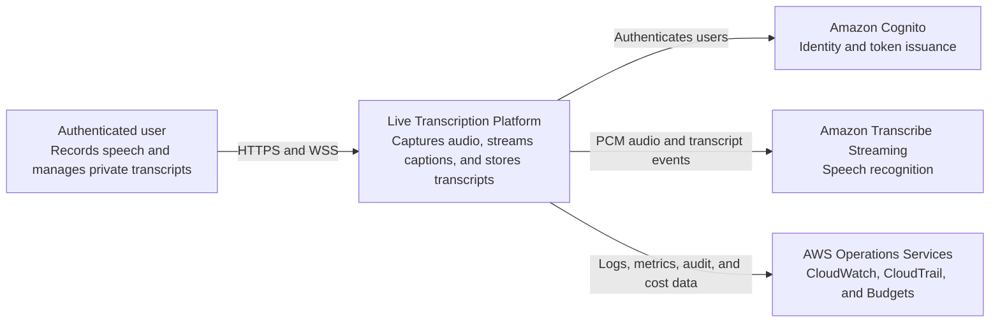
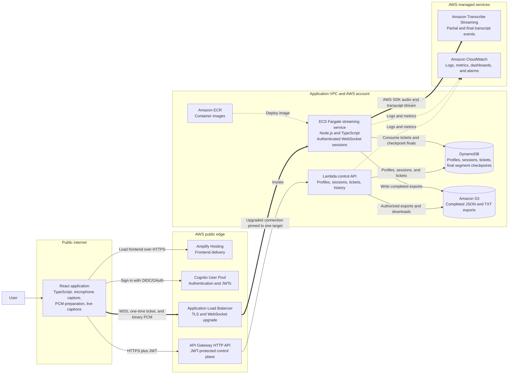

# Architecture: Multi-User Live Speech-to-Text Platform

Status: Proposed for team review  
Architecture option: B — backend-mediated streaming  
Last reviewed: 2026-11-01

This document describes the target architecture. It does not claim that any resource is deployed or that any performance target has been verified. Decisions marked `PROPOSED` require team approval and an accepted architecture decision record (ADR).

## Goals and boundaries

The MVP lets multiple authenticated users independently stream microphone audio, view live captions, and later manage their own transcripts. Each logical session belongs to one Cognito subject and normally owns one Amazon Transcribe Streaming connection at a time.

The MVP does not provide shared rooms, microphone mixing, speaker identity, raw-audio recording, AI summaries, or seamless migration of an active WebSocket between containers. Those capabilities require separate designs.

## System context



Text fallback:

```text
Authenticated user
        |
        | HTTPS and WSS
        v
Live Transcription Platform
        |-- authentication ----------> Amazon Cognito
        |-- PCM and transcript stream -> Amazon Transcribe Streaming
        `-- operational telemetry ----> CloudWatch, CloudTrail, and Budgets
```

## Containers and trust boundaries



Text fallback:

```text
Browser / React
   |-- HTTPS + JWT --> API Gateway --> Lambda control API
   |                                      |-- DynamoDB: profiles, sessions, tickets
   |                                      `-- S3: transcript exports/downloads
   |
   `-- WSS + ticket + PCM --> ALB --> ECS/Fargate streaming service
                                           |-- Amazon Transcribe Streaming
                                           |-- DynamoDB final-segment checkpoints
                                           |-- S3 completed exports
                                           `-- CloudWatch logs and metrics

ECR -- container image --> ECS/Fargate
Cognito -- authentication/JWT --> Browser and HTTP control plane
```

The browser, public edge, application runtime, AWS managed data services, and Transcribe are separate trust zones. Crossing a boundary requires TLS, authentication where applicable, authorization, validation, and privacy-safe telemetry.

## Option B versus Option A

| Concern | Option A: browser to Transcribe | Option B: backend mediated |
|---|---|---|
| AWS credential exposure | Requires browser-facing temporary signing capability | AWS credentials remain on the ECS task role |
| Protocol control | Browser owns provider protocol | Application owns a versioned provider-neutral protocol |
| Authoritative final results | Client-reported | Backend-observed and checkpointed |
| Backpressure and quotas | Distributed across clients | Centrally enforced |
| Operational cost | Lower | ALB and continuously available Fargate capacity |
| Complexity | Lower | Higher: socket lifecycle, draining, reconnect, scaling |
| Future permitted fan-out | Difficult | Extension point exists |

Option B is selected because lifecycle control, authoritative persistence, quota enforcement, and future fan-out are product requirements. This choice does not make active sockets portable between tasks.

## Control path

1. Cognito authenticates the user. API Gateway validates the JWT for HTTP routes.
2. `POST /v1/sessions` derives `userId` from validated claims, applies admission policy, creates a `CREATED` session, and issues a short-lived one-time ticket.
3. The browser opens `wss://stream.<domain>/v1/stream` and presents the ticket using the mechanism selected in ADR-001.
4. ECS atomically consumes the ticket and conditionally moves the session toward `CONNECTING`/`STREAMING`.
5. History and mutation APIs always derive ownership from the authenticated subject and use owner-scoped keys or conditional checks.

The control API is the authority for user-initiated lifecycle operations. The streaming worker is the authority for runtime observations and final-segment checkpoints. Allowed state transitions are shared in `packages/contracts`; neither service may invent states.

## Streaming data path

1. An AudioWorklet supplies mono floating-point samples at the browser's native rate.
2. The stream client resamples to the approved rate and encodes signed 16-bit little-endian PCM without a WAV header.
3. The client sends uniform binary chunks, initially proposed at 100 ms. AWS recommends real-time, uniform chunks between 50–200 ms.
4. The ECS service validates sequence, size, rate, session state, and queue capacity before passing chunks to the Transcribe SDK.
5. Provider partial results are mapped to ephemeral `partial_transcript` events.
6. Provider final results receive a deterministic `(sessionId, streamEpoch, providerResultId)` identity and are conditionally checkpointed before or concurrently with delivery, according to ADR-003.
7. Stop closes the audio input, waits a bounded time for final events, reconciles checkpoints, creates exports, and only then marks the session terminal.

## Concurrency and scaling

One active user session normally consumes one Transcribe stream. Admission therefore considers both application capacity and the verified account/Region Transcribe quota. Quotas must be queried for each environment; documentation values are not deployment facts.

The service scales horizontally using a combination of:

- active streams per task;
- CPU and memory;
- event-loop/audio processing lag;
- queue depth or dropped-frame count;
- connection start rate.

Distributed admission uses conditional DynamoDB writes or another approved atomic store. Per-process counters are telemetry, not the global quota authority.

An ALB selects an ECS target when upgrading the WebSocket and sends that connection's later messages to the same target. A task failure ends the connection. Sticky sessions are not required for an already-upgraded socket and do not provide failover.

`PROPOSED`: keep at least two tasks in staging/production, set a measured maximum active streams per task, and scale before either application or Transcribe capacity is exhausted. Exact numbers follow load tests.

## Reconnect and stream epochs

The logical `sessionId` survives transport reconnects. Each accepted provider stream has a monotonically increasing `streamEpoch`. A reconnect obtains a new one-time ticket and may begin a new epoch after ownership/state checks.

The client reports its last acknowledged server sequence for diagnostics; it does not authoritatively replay transcript content. Already checkpointed final segments can be rehydrated from persistence. Audio that existed only in the browser and was lost during disconnection cannot be recovered.

When the provider's maximum stream duration approaches, the worker rotates to a new epoch. The exact overlap/buffering and reconciliation policy remains proposed in ADR-004 and must be measured before any continuity claim.

## Failure model

| Failure | Required outcome |
|---|---|
| Invalid/expired/replayed ticket | Reject before audio; privacy-safe structured error |
| Malformed/oversized audio frame | Reject frame or close by policy; isolate the session |
| Slow client or Transcribe consumer | Bounded queue; warning then controlled termination, never unbounded memory |
| Transcribe throttling/quota | Admission rejection or bounded retry; explicit status and retry guidance |
| ECS termination | Stop accepting connections, notify clients if possible, checkpoint finals, drain until deadline |
| Client disconnect | Mark disconnected/interrupted after grace period; preserve checkpoints |
| DynamoDB checkpoint failure | Bounded retry; never report durable completion prematurely |
| S3 export failure | Keep checkpoints; terminal state remains finalizing/failed until retry policy resolves |
| Duplicate provider event | Conditional segment write is idempotent |
| Delete partially fails | Tombstone as `DELETING`, retry all objects, deny reads immediately |

ALB deregistration and ECS stop timeouts must accommodate long-lived streams. AWS explicitly warns against a five-second deregistration delay for streaming connections. Values require a termination test, not guesswork.

## Security and privacy

- TLS on every public route; private buckets with block-public-access.
- JWT identity is accepted only after API Gateway or server-side verification.
- Session IDs are opaque; all operations also enforce owner identity.
- Tickets are short-lived, one-time, session-bound, and atomically consumed.
- ECS execution and task roles are distinct and least privilege.
- Audio, transcript text, JWTs, tickets, and signed URLs are prohibited from routine logs.
- Origin, frame size, message rate, idle timeout, per-user concurrency, and total admission limits are enforced.
- Raw audio is not persisted by default. Retention and deletion policies require product/legal approval.
- Encryption uses AWS-managed keys initially unless an approved requirement justifies customer-managed KMS keys.

See `docs/security.md` for the threat model and controls.

## Data ownership and storage

DynamoDB is the source for session state, ownership, tickets, and durable final segments. S3 holds completed immutable export artifacts. The frontend never receives arbitrary DynamoDB or S3 access. Downloads are short-lived, authorized responses.

The initial table shape is proposed in `docs/data-model.md`. It favors owner-scoped queries and conditional writes. Capacity mode, PITR, S3 versioning, KMS choice, and retention remain environment decisions.

## Observability

All components emit structured logs with `service`, `environment`, `requestId` or `correlationId`, `sessionId`, `streamEpoch`, `event`, `outcome`, `errorCode`, and duration fields where relevant. `userId` is excluded or irreversibly pseudonymized in operational logs.

Required measures include active streams, admission outcomes, capture-to-partial/final latency, audio lag, queue pressure, Transcribe failures, checkpoint lag, export outcomes, reconnect outcomes, and estimated service usage. Metric names are defined once by Person 5 and provisioned by Person 4.

## Cost drivers and controls

Primary variable cost drivers are Transcribe streaming minutes, Fargate task-hours, ALB capacity, CloudWatch ingestion/retention, DynamoDB operations/storage, S3 storage/requests, NAT data processing if used, and data transfer. The design should avoid NAT where supported endpoints or public service access with secure egress is more economical, subject to a reviewed network design.

Each non-production environment has tags, a budget, log retention, resource teardown guidance, bounded load tests, and no accidental production-scale minimum capacity.

## Deployment environments

CDK in `infrastructure/` defines independently deployable `dev`, `staging`, and `prod` configurations. Accounts versus stacks, Region, domain names, removal policies, data retention, and deployment approval are resolved by ADR-007. Agents may not deploy or alter shared AWS environments without authorization.

## References

- [Amazon Transcribe streaming](https://docs.aws.amazon.com/transcribe/latest/dg/streaming.html)
- [StartStreamTranscription API](https://docs.aws.amazon.com/transcribe/latest/APIReference/API_streaming_StartStreamTranscription.html)
- [Amazon Transcribe endpoints and quotas](https://docs.aws.amazon.com/general/latest/gr/transcribe.html)
- [ALB target group attributes](https://docs.aws.amazon.com/elasticloadbalancing/latest/application/edit-target-group-attributes.html)
- [ECS connection draining](https://docs.aws.amazon.com/AmazonECS/latest/developerguide/load-balancer-connection-draining.html)

