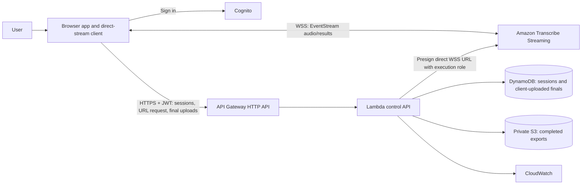

# Architecture: Option A Direct Browser Streaming

Status: target architecture for team review; no Option A application or deployment exists. Last reviewed: 2026-11-05.

## Goal and boundaries

Multiple authenticated users independently capture speech, see live captions, and manage their own saved transcripts. The browser connects directly to Amazon Transcribe Streaming. API Gateway/Lambda handle identity-aware control and persistence, not continuous audio. Raw microphone audio is not stored by default. Shared rooms, audio recording, speaker identity, and server-verified transcript provenance are outside this design.

The browser obtains a short-lived presigned WebSocket URL from the authenticated API. Lambda's execution role has the required Transcribe WebSocket action. The URL can contain a credential identifier and temporary session token; the browser must never receive the secret access key or derived signing key. The entire URL is a bearer capability and must be excluded from logs, analytics, browser history, and persistent storage. AWS permits `X-Amz-Expires` of at most 300 seconds; this is the **connection-start validity**, not a guarantee of stream duration. [AWS WebSocket protocol guide](https://docs.aws.amazon.com/transcribe/latest/dg/streaming-setting-up.html)

## Stream path

1. AudioWorklet captures native-rate browser audio. Browser code converts to mono, resamples to 16 kHz, and encodes signed 16-bit little-endian PCM. The initial target is 100 ms chunks of 3,200 PCM bytes; browser compatibility and quality still need testing.
2. `packages/stream-client` frames PCM as Amazon EventStream audio events, handles bounded buffering/cancellation, and decodes EventStream transcript or exception messages. Lambda signs the connection URL; the browser receives no secret signing key. The browser sends **no** former 16-byte application header to Transcribe.
3. Partial results are ephemeral UI state. Final results can be shown immediately, then submitted through the authenticated HTTP API and visibly marked saved only after acknowledgment.
4. The API validates shape/size, derives the owner from verified identity, checks the session in DynamoDB, and idempotently writes final segments. It cannot authenticate the content's provider origin because the provider-to-browser path is outside its view.
5. The browser requests completion only after the provider stream ends and all finals it observed have API save acknowledgments. Finalization exports those acknowledged uploads to private S3 before reporting export readiness. The API cannot prove the browser submitted every provider final; recovery after a tab crash can use only already acknowledged finals.

The exact final-upload shape, retry window, upload bounds, and state transitions are `PROPOSED` in [API_CONTRACTS.md](API_CONTRACTS.md) and [docs/data-model.md](docs/data-model.md); owners must review them before code.

## Control, trust, and recovery

- Cognito authenticates the user; API Gateway validates the token; Lambda derives the user subject from validated claims. Client-supplied `userId` never grants access.
- The signing endpoint checks owner, session state, issuance rate, language, format, and Region before returning a narrowly configured presigned URL. Issuance limits cannot guarantee active Transcribe concurrency: AWS does not make the URL a one-time application ticket or bind it to the DynamoDB session. The team must document replay/cost risk, verify account quotas, and use short expiry and monitoring.
- A direct Transcribe disconnect interrupts live audio. Reconnect requests a fresh URL and starts a new provider stream epoch; lost microphone audio is not promised recoverable. Partial text is discarded. Only acknowledged finals are durable.
- Transcribe stream-duration, account quota, and start-rate limits must be verified in the chosen Region/account. The browser must handle provider errors and bounded backpressure without silently dropping audio.
- DynamoDB is authoritative for ownership, application session state, and saved results. S3 holds private exports. Deletion immediately denies application reads, then retryably removes content according to an approved retention policy.

## What remains undecided

`TBD`: Region/data residency; consent and retention; precise session lifecycle; final-segment identity and ordering; concurrency/admission target; expiry shorter than AWS's maximum; export retry/deletion policy; supported browsers; deployment account layout and budget. See [decision queue](docs/orchestrator/decision-queue.md). None of these are implied by the prior Option B documents.
