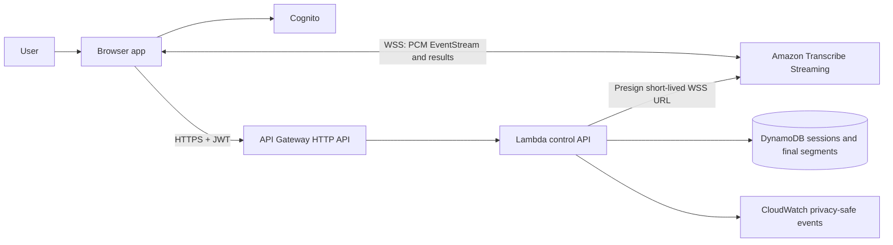

# Architecture: Option A Phase 1 Live MVP

Status: active target architecture. A manually configured `us-east-2` development stack verified the narrow authenticated direct-browser live-caption path on 2026-11-07; the durable Phase 1 application is not complete. Last reviewed: 2026-11-07.

## Integrated system



The live audio data plane is browser-to-Transcribe. The application control plane is browser-to-API Gateway/Lambda. No application backend proxies continuous audio.

The development smoke stack currently implements only Cognito identity and `POST /v1/sessions/{sessionId}/stream-url`, backed by a guarded, non-durable single-session Lambda repository. It verified the diagram through live captions but does not implement the DynamoDB, final-save, completion, history, deletion, reconnect, or one-hour portions of this architecture.

## Phase 1 flow

1. Cognito authenticates the user.
2. `POST /v1/sessions` creates an owned `CREATED` application session.
3. `POST /v1/sessions/{id}/stream-url` verifies ownership/state and returns a non-cacheable, short-lived Transcribe URL plus the authorized stream epoch and PCM parameters.
4. The browser captures microphone audio, converts it to mono 16 kHz signed 16-bit little-endian PCM, and gives 100 ms chunks to `packages/stream-client`.
5. The stream client encodes Amazon EventStream audio frames, handles bounded buffering, and decodes partial/final transcript or exception events.
6. The UI displays partials ephemerally. It submits finals to the authenticated segments endpoint with stable result identity and idempotency data.
7. The UI marks a final saved only after the API conditionally writes and acknowledges it in DynamoDB.
8. Stop ends the provider stream, waits for observed final uploads to settle, and calls `complete`.
9. History reads the same acknowledged finals. Delete denies future reads and removes Phase 1 records.

## One-hour logical session

Phase 1 targets at least one hour of live use. The application session survives provider reconnects:

```text
application session
  ├── stream epoch 1
  ├── stream epoch 2 after reconnect
  └── one ordered set of acknowledged final segments
```

A reconnect requests a fresh URL and increments the epoch under API control. Lost microphone audio and unacknowledged browser-only finals are not promised recoverable. The browser must surface interruption rather than silently claim continuity.

## Trust and durability

- API Gateway validates the Cognito token; Lambda derives the owner from validated claims and checks DynamoDB ownership.
- Lambda signs with runtime IAM credentials. The browser never receives a secret access key or derived signing key.
- The URL is a replayable bearer capability until expiry, not a one-time ticket. The initial proposed expiry is 60 seconds and must be verified.
- URL expiry limits connection start, not an already established stream. Stop behavior, abnormal usage, and provider limits remain separate concerns.
- Transcribe results reach the browser. Saved live text is untrusted `client-uploaded` content.
- Partials are not durable. Only API-acknowledged finals appear in history.
- Raw audio, transcript text, JWTs, signed URLs, and personal data never enter routine logs or metric dimensions.

## Phase 1 storage

DynamoDB is authoritative for owner, session state/version, current stream epoch, and acknowledged final segments. Phase 1 does not require S3 exports or raw-audio storage.

## Deferred architecture

Recorded-file transcription will require a separate upload/batch path; summarization and other derived artifacts will consume saved transcripts. Neither is part of the Phase 1 runtime or contracts. S3 exports, advanced retention/backups, production environments, and production-scale admission are also deferred.
