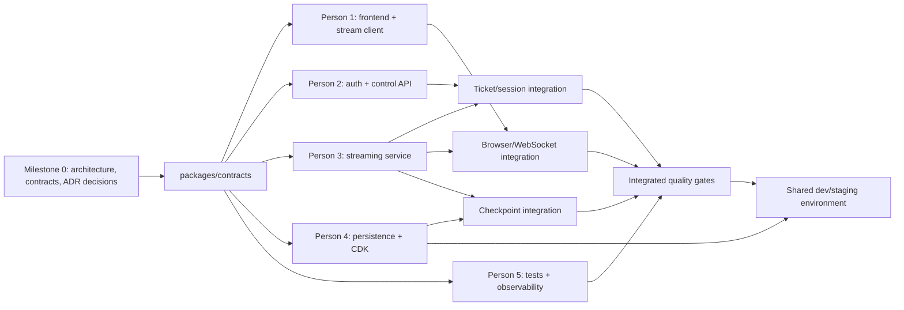

# Integration and Delivery Plan

Status: active team plan; unresolved items remain gated by proposed ADRs

Last reviewed: 2026-11-02

## Objective

Deliver one contract-driven Option B system in thin, continuously integrated vertical slices. Component owners may work concurrently only after shared interfaces are approved. Mocks reproduce shared contracts and are replaced at defined checkpoints.

## Current checkpoint

Completed foundation:

- Node.js/npm/TypeScript/Zod/Vitest/ESLint/Prettier baseline and workspace lockfile;
- accepted binary PCM/header contract with codec and continuity tests;
- official Amazon Transcribe SDK adapter behind `TranscriptionProvider`;
- deterministic fake-SDK provider tests and WAVE/raw-PCM smoke runner;
- bounded manual synthetic-audio Transcribe success in `us-east-1`;
- development account plan enabled and a $20 monthly AWS Budget alert configured.

Not complete: structured Zod HTTP/WebSocket schemas, authentication/session/persistence decisions, frontend, control API, WebSocket service, storage adapters, CDK, deployment and end-to-end tests.

## Dependency graph

## Milestone 0: contract freeze

Required approvals:

- Option B boundaries and non-goals.
- Cognito subject and owner-only authorization model.
- Session states and transition owners.
- HTTP v1 shapes and standard errors.
- Ticket representation, transport, lifetime, consumption, and reconnect renewal.
- WebSocket v1 envelopes, binary header, audio format, and initial limits.
- Segment identity/checkpoint ordering and export completion semantics.
- DynamoDB/S3 model direction.
- Telemetry field/metric names.
- Region, environment/account strategy, budget, and authorized deployers.

The decision register records approvers/dates. Contract changes after freeze are additive or versioned.

## First implementation tasks by owner

Owners may begin the isolated/fake-backed work below when its specific dependencies are accepted. Coupled or deployed work remains gated; Milestone 0 is not globally complete.

### Person 1 — frontend

1. Scaffold the approved React/TypeScript workspace and authentication shell.
2. Implement a contract-generated HTTP client and a mocked session dashboard.
3. Build AudioWorklet capture/resampling with PCM golden-vector tests.
4. Implement `stream-client` state machine against the mock WebSocket server.
5. Add recording permission, connecting/reconnecting/finalizing, and accessible error UX.

Handoff: PCM vectors and browser events to Person 3; contract failures and UI needs to Person 2/3.

### Person 2 — identity and control API

1. Define Cognito/CDK requirements with Person 4 and API authorizer claims.
2. Implement profile and session create/read/list/rename/complete/delete handlers behind repositories.
3. Implement idempotency and owner-scoped authorization tests.
4. Implement ticket issuer/refresh adapter and contract fixtures.
5. Provide local/mock identity injection that cannot be enabled in deployed production.

Handoff: ticket fixtures/verification contract to Person 3; data access interfaces to Person 4.

### Person 3 — streaming and orchestration

1. Scaffold the Node/TypeScript service with health/readiness and graceful shutdown.
2. Implement protocol parser/state machine and binary-frame validation without AWS first.
3. Implement ticket verifier and session lease interfaces using Person 2/4 mocks.
4. Integrate the existing `TranscriptionProvider`/Amazon Transcribe adapter into the service state machine while retaining a fake provider for tests.
5. Add bounded queues, deduplication, checkpoint adapter, metrics hooks, and fault tests.
6. Exercise the existing official SDK adapter through the approved dev deployment; do not make default tests depend on AWS.

Handoff: `stream-client` contract to Person 1; ticket requirements to Person 2; checkpoint/lease calls to Person 4; instrumentation points to Person 5.

### Person 4 — data and platform

1. Finalize table/index/object schemas with migration/version strategy.
2. Implement persistence adapters and DynamoDB/S3 contract tests using emulators/mocks where appropriate.
3. Create CDK stacks for identity/control, data, network/streaming, hosting, and observability boundaries.
4. Provision ECR, Fargate service, ALB, health checks, roles, log groups, and approved environment configuration.
5. Implement safe deployment/rollback and secrets-free GitHub OIDC plumbing.

Handoff: typed repository/lease/checkpoint interfaces to Persons 2/3; environment endpoints and rollback guide to team.

### Person 5 — evaluation and release quality

1. Migrate existing WER scripts without losing provenance; make them import-safe, tested, and pinned.
2. Define telemetry schema/metrics with low-cardinality labels and measurement clocks.
3. Build protocol/API fixtures, integration harness, two-user isolation test, and bounded load plan.
4. Specify dashboards/alarms/runbooks; Person 4 provisions, Persons 2/3 instrument.
5. Publish baseline WER/latency/recovery/capacity report with environment and dataset versions.

Handoff: metric names and instrumentation acceptance to Persons 2–4; release report to all owners.

## Shared contracts package

As contracts are accepted, `packages/contracts` contains:

- runtime schemas and inferred TypeScript types;
- OpenAPI source/generated artifact for HTTP v1;
- WebSocket envelope/control/event schemas;
- session states and transition metadata;
- standard application error codes;
- binary-frame encode/decode golden vectors;
- telemetry event names/fields.

Publication is workspace-local initially. Contract tests verify examples in `API_CONTRACTS.md` or generate examples from schemas to avoid drift.

## Contract-compliant mocks

| Mock | Provider | Consumers | Exit condition |
|---|---|---|---|
| HTTP API fixture/server | Person 2 | Person 1, e2e | Real dev API passes same contract suite |
| WebSocket streaming simulator | Person 3 | Person 1, e2e | ECS service with fake then real Transcribe passes suite |
| Ticket verifier/issuer fixture | Persons 2/3 | API + streaming | Atomic real store integration passes replay/race tests |
| Fake Transcribe adapter | Person 3 | streaming tests | Approved dev integration passes partial/final/error tests |
| Persistence repository | Person 4 | Persons 2/3 | DynamoDB/S3 adapter passes repository contract suite |
| Telemetry sink | Person 5 | Persons 2–4 | Staging metrics/log assertions pass |

Mocks must validate the same schemas and error codes. A mock-only behavior cannot become an undocumented dependency.

## Integration checkpoints

Hold a short checkpoint at least twice weekly while active integration is underway. Demonstrate from merged `main`, not an owner's private branch.

1. Contract smoke: **partial** — binary codec builds/tests; structured HTTP/WebSocket runtime schemas remain.
2. Provider smoke: **complete locally/manual** — sample PCM file → official SDK → Transcribe partial/final; no ECS/checkpoint/export.
3. Local vertical slice: sample PCM → fake stream → captions → fake checkpoint → history.
4. AWS speech slice: sample PCM → ECS/dev worker → Transcribe → checkpoint/export.
5. Authenticated slice: Cognito sign-in → ticket → live microphone → history.
6. Isolation slice: two users stream concurrently and cannot access each other.
7. Failure slice: disconnect/task drain/provider/persistence failure has truthful state and retained finals.
8. Bounded scale slice: approved N streams with admission rejects, metrics, cost record, and cleanup.

At every checkpoint ask: can current merged `main` sign in, stream one versioned sample, save a transcript, and retrieve it?

## Test environment strategy

### Local

- No required AWS credentials for unit/contract tests.
- Contract fixtures, fake Transcribe, repository fakes, and a local WebSocket server.
- Optional emulators must not define behavior that differs silently from AWS.

### Dev

- Developer integration with bounded resources and synthetic/non-sensitive audio.
- Manual or branch deployments only through approved mechanism.
- Short retention and explicit cleanup.

### Staging

- Production-shaped trust boundaries at small capacity.
- Shared acceptance, failure injection, dashboards, alarms, and bounded load tests.
- Versioned reference audio with documented rights/consent.

### Production

- No agent-initiated deployment.
- Protected approval, immutable artifact promotion, migration/rollback plan, security and release sign-off.

## CI expectations

As implementation arrives, required checks evolve in reviewed PRs:

1. secret and dependency review/scanning;
2. formatting and lint;
3. TypeScript typecheck/build;
4. Python evaluation lint/tests;
5. unit tests and coverage trend;
6. contract/example compatibility;
7. CDK synth and infrastructure assertions without deployment;
8. integration smoke with local mocks;
9. container build and vulnerability scan;
10. e2e staging test only in an authorized protected workflow.

The bootstrap CI deliberately runs only repository checks that currently exist. It uses no AWS secrets and does not deploy.

## Branch, review, and release

- Protected `main`; short-lived branches and small PRs.
- Domain owner reviews owned paths; orchestrator reviews public/cross-component interfaces.
- Contract or architecture change links an ADR and lists all consumers.
- Merge order: contract → producer implementation → consumer implementation/migration → removal of old contract.
- Release uses immutable application/container versions and records contract/schema versions.
- Rollback checks schema compatibility and cannot simply restore code that cannot read newly written data.

## Quality gates

Milestone 1 requires one complete authenticated path, checkpoint durability, export/history, basic failure behavior, privacy-safe telemetry, and documented actual tests.

Milestone 2 additionally requires two-user isolation, distributed admission behavior, task draining/reconnect, bounded load evidence, and baseline WER/latency/cost.

Milestone 3 additionally requires security review, retention/deletion approval, alarms/runbooks demonstrated, backup/rollback decisions, vulnerability remediation, and team release sign-off.

## Risks and mitigations

| Risk | Mitigation |
|---|---|
| Five divergent models | Contract-first shared package and owner reviews |
| Browser audio incompatibility | Golden vectors and early browser matrix |
| Ticket leakage/replay | ADR-001 proof and security tests before microphone integration |
| AWS quota/cost surprise | Account/Region verification, conservative admission, budgets, bounded tests |
| WebSocket loss during deploy | SIGTERM/draining/reconnect tests and truthful interruption |
| Final transcript loss/duplicates | Conditional checkpoints and deterministic identities |
| False performance claims | Versioned methodology and baseline evidence |
| Sensitive content exposure | No raw audio persistence; log redaction tests; retention approval |
| Contributor starts in the outer non-repository folder | Documentation and onboarding require the canonical `MSML650-Term-Project` root |

## Immediate team review agenda

1. Merge the reviewed foundation branch and protect `main`; add team GitHub handles/CODEOWNERS.
2. Review ADR-001, then ADR-002, then ADR-003; do not batch all decisions into one meeting.
3. Freeze the smallest WebSocket v1 subset around accepted ADR-006 audio framing.
4. Record target peak concurrent streams and verify the current Transcribe quota before load/deployment design.
5. Review ADR-007 cleanup, idle-cost, account/environment and deployment authorization details.
6. Assign Milestone 1 issues by the owner table in the root README and demonstrate twice-weekly merged checkpoints.

