# Streaming Protocol Specification

Status: Proposed for team review  
Protocol: `live-transcription.v1`

`API_CONTRACTS.md` defines public shapes. This document defines lifecycle and implementation behavior.

## Connection lifecycle

```mermaid
stateDiagram-v2
  [*] --> Upgrading
  Upgrading --> Authenticated: valid ticket consumed
  Upgrading --> Closed: authentication rejected
  Authenticated --> Starting: start received
  Starting --> Streaming: provider ready; server sends ready
  Starting --> Closing: start/provider failure
  Streaming --> Finalizing: stop or rotation
  Streaming --> Disconnected: transport lost
  Streaming --> Closing: policy/dependency failure
  Finalizing --> Completed: checkpoints reconciled; exports durable
  Finalizing --> Interrupted: deadline/dependency failure
  Completed --> Closing
  Interrupted --> Closing
  Disconnected --> [*]
  Closing --> [*]
```



The server accepts no audio before `ready`. A connection has one logical session and one active epoch. A session reconnect creates a new connection and normally a new epoch.

## Audio contract

Initial proposal:

- mono;
- signed 16-bit little-endian PCM;
- 16,000 samples/second;
- no WAV/container header;
- uniform 100 ms payloads, with 50–200 ms accepted;
- silence encoded as zero-valued PCM samples.

At 16 kHz mono, 100 ms is 1,600 samples or 3,200 bytes. The browser must resample its native AudioContext rate and clamp/quantize float samples correctly. AudioWorklet processing must stay off the React render path.

The binary application header in `API_CONTRACTS.md` provides version, sequence, and capture position. Browser and server test vectors must prove byte order and sample conversion before integration.

## Timing

Three clocks are not interchangeable:

1. Audio sample position: authoritative ordering/duration derived from samples.
2. Monotonic client/server time: latency measurement within a process/device.
3. UTC wall clock: correlation across services, subject to skew.

Caption latency methodology must avoid subtracting unsynchronized browser/server clocks without a documented clock-offset method. Server receipt/provider/result/checkpoint timestamps are captured separately.

## Sequencing and gaps

Client audio sequence increases by one for every binary frame. Server event sequence increases for every JSON event. Duplicate binary sequences are rejected; small reordering is not buffered in v1. A gap emits a warning/metric and may terminate according to approved thresholds.

Session-relative capture position must match cumulative audio within tolerance. Large jumps, negative progression, or frames substantially faster than real time are policy errors.

## Backpressure

Each connection has finite stages:

```text
socket receive -> validated audio queue -> Transcribe SDK input
Transcribe events -> checkpoint queue -> client event queue
```

No stage may grow without limit. Proposed audio capacity is two seconds per session, subject to load testing. High-water marks emit metrics/warnings. At the hard limit the service closes the affected stream with `BACKPRESSURE_LIMIT`, checkpoints existing final segments, and marks the session according to lifecycle policy.

WebSocket library buffered-byte metrics, Node stream backpressure, SDK cancellation, and client `bufferedAmount` must be tested. Dropping arbitrary PCM frames silently is prohibited.

## Partial and final results

Provider payloads are mapped into application events. A partial replaces the prior partial with the same `(epoch, resultId)`. It is never persisted as truth. A final result is deduplicated, assigned a segment identity/ordinal, and checkpointed.

Provider result IDs are not assumed globally unique. Empty alternatives and unexpected provider events are handled without crashing the process. Raw provider payloads are not logged.

## Stop and finalization

On `stop`:

1. stop accepting binary frames;
2. verify `lastAudioSequence` against received data;
3. close/end SDK audio input;
4. await remaining provider results up to a configured deadline;
5. finish checkpoint retries within policy;
6. reconcile segment identities/order;
7. create JSON/TXT exports;
8. conditionally mark `COMPLETED`, otherwise explicit `INTERRUPTED`/`FAILED`;
9. send final status and close.

Deadlines require measurement. Client disconnection during finalization does not cancel server persistence.

## Heartbeats and idle behavior

The design uses application `ping` messages because browser WebSocket APIs do not expose arbitrary protocol-level ping frames. The server may also use protocol ping/pong toward supported clients. Intervals must be shorter than the configured ALB idle timeout and include jitter/tolerance.

Silence is still audio and should be sent as zero PCM when the session is active. No messages, missing heartbeats, and explicit silence are different conditions.

## Reconnection

The client requests a new ticket through HTTPS. The server validates state and atomically starts a new connection attempt/epoch. Durable final segments remain authoritative. Partials disappear. Audio lost while disconnected is not reconstructed in v1.

Only one active worker lease may advance the current epoch. If concurrent reconnects race, one succeeds and the other receives a conflict. Exact grace period and whether the old socket is actively displaced require ADR approval.

## Rotation

Before the provider hard session-duration limit, the worker initiates a new provider stream epoch. Candidate strategy:

- start rotation with a bounded PCM overlap buffer;
- assign the new epoch an offset;
- send overlap to the new stream;
- reconcile final text/timestamps near the boundary;
- stop the old stream after its final events.

This is a hypothesis, not a continuity guarantee. Buffer duration, simultaneous provider capacity, duplicate-text matching, and boundary WER must be tested. If safe overlap cannot be achieved, the system exposes an explicit brief interruption.

## Deployment draining

On SIGTERM the task becomes unready, refuses new upgrades, emits `SERVER_DRAINING`, and gives active sessions time to finalize or reconnect. ALB deregistration delay and ECS stop timeout must be set together and tested with real WebSockets. A short HTTP-oriented drain value is unsafe for streaming.

## Close behavior

Use standard codes where possible:

- `1000`: normal completed close;
- `1001`: task/server going away;
- `1002`: protocol/framing violation;
- `1003`: unsupported data type;
- `1008`: authentication/authorization/rate policy after upgrade;
- `1009`: message too large;
- `1011`: unexpected dependency/server failure;
- `1012`: service restart, where client library support is verified;
- `1013`: temporary overload, where support is verified.

Application error JSON should precede a close when safe. Close reasons are short and contain only stable codes.

## Required protocol tests

- PCM conversion golden vectors and resampling quality.
- Valid start/ready/audio/partial/final/stop flow.
- Audio before ready; JSON after stop; binary/header corruption.
- Duplicate, missing, reordered, oversized, too-fast, and slow frames.
- Ticket replay and concurrent connect race.
- Slow client/SDK and every queue high-water/hard limit.
- Transcribe error, checkpoint failure, export failure, socket loss, SIGTERM.
- Epoch rotation boundary duplicates/gaps and long-session memory stability.
- One bad session does not affect a second healthy session.

## Open decisions

- Final ticket transport.
- Exact frame timestamp representation.
- Queue and gap thresholds.
- Heartbeat and ALB idle values.
- Stop/finalization deadlines.
- Resume grace and competing connection behavior.
- Rotation threshold, overlap, and reconciliation algorithm.

